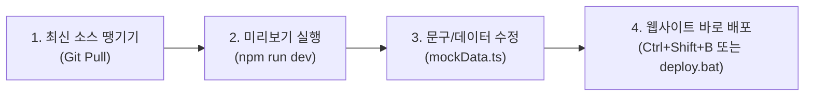

# 📘 기획자를 위한 웹사이트 소스 작업 & 배포 가이드

이 문서는 개발 지식이 없는 **기획자, 마케터, 운영자**도 소스코드를 안전하게 내려받아(Pull), 
로컬에서 화면을 직접 확인하며 문구/이미지를 수정하고, 실시간으로 웹사이트에 배포할 수 있도록 안내하는 가이드입니다.

---

## 📌 목차
1. [작업 흐름 한눈에 보기](#1-작업-흐름-한눈에-보기)
2. [처음 시작하기 (초기 세팅)](#2-처음-시작하기-초기-세팅)
3. [최신 소스 가져오기 (Git Pull)](#3-최신-소스-가져오기-git-pull)
4. [실시간 화면 보며 작업하기 (로컬 미리보기)](#4-실시간-화면-보며-작업하기-로컬-미리보기)
5. [어디를 고치면 사이트가 바뀌나요? (핵심 수정 가이드)](#5-어디를-고치면-사이트가-바뀌나요-핵심-수정-가이드)
6. [수정 내용 웹사이트에 바로 배포하기](#6-수정-내용-웹사이트에-바로-배포하기)
7. [자주 하는 실수 & 주의사항](#7-자주-하는-실수--주의사항)

---

## 1. 작업 흐름 한눈에 보기



---

## 2. 처음 시작하기 (초기 세팅)

새로운 PC에서 처음 작업할 때 딱 한 번만 진행합니다.

### 🚀 방법 A: 원클릭 자동 셋업 (가장 추천 ⭐)
1. 프로젝트 폴더의 **`기획자_원클릭_셋업.bat`** (또는 `setup.bat`) 파일을 더블클릭합니다.
2. Git 및 Node.js 설치 확인, 최신 소스 다운로드, VS Code 실행까지 **전부 자동으로 진행**됩니다.
3. 스크립트 실행 후 VS Code가 열리면 터미널에서 다음 명령어를 입력합니다:
   ```bash
   npm install
   ```
   *(배치 파일 창에서 바로 `Y`를 누르면 `npm install`까지 자동으로 완료됩니다!)*

### 방법 B: 수동 세팅
1. **Visual Studio Code** 실행
2. 상단 메뉴 `파일` → `폴더 열기(Open Folder)` 클릭
3. `C:\Project\open-the-share-website` 폴더 선택 후 열기
4. 상단 메뉴 `터미널(Terminal)` → `새 터미널(New Terminal)` 열기
5. 터미널 창에 다음 명령어 입력 후 엔터:
   ```bash
   npm install
   ```

---

## 3. 최신 소스 가져오기 (Git Pull)

다른 팀원이 수정한 최신 내용을 내 컴퓨터로 가져옵니다. **작업을 시작하기 전 항상 먼저 실행하세요.**

### 방법 A: VS Code 화면에서 클릭
* VS Code 좌측 세 번째 아이콘(**소스 제어 / Git 모양**) 클릭
* 상단 점 3개(`...`) 메뉴 클릭 → **`풀(Pull)`** 클릭

### 방법 B: 터미널에서 입력
```bash
git pull origin master
```

---

## 4. 실시간 화면 보며 작업하기 (로컬 미리보기)

내가 수정한 텍스트가 브라우저에 어떻게 나오는지 실시간으로 확인하는 방법입니다.

1. VS Code 터미널에서 아래 명령어 실행:
   ```bash
   npm run dev
   ```
2. 터미널에 나온 주소(`http://localhost:5173/open-the-share-website/`)를 **`Ctrl` 키를 누른 채 클릭**하거나 브라우저 주소창에 복사/붙여넣기합니다.
3. 이제 코드를 수정하고 **`Ctrl + S` (저장)** 를 누르면, 브라우저가 새로고침 없이 **즉시 변경된 내용**을 보여줍니다.
4. 작업이 끝나면 터미널 창에서 **`Ctrl + C`** 를 눌러 미리보기를 종료할 수 있습니다.

---

## 5. 어디를 고치면 사이트가 바뀌나요? (핵심 수정 가이드)

웹사이트에 노출되는 텍스트, 숫자, FAQ, 포트폴리오의 95%는  
👉 **`src/data/mockData.ts`** 파일 단 하나에 모두 모여 있습니다!

VS Code 좌측 탐색기에서 `src` → `data` → **`mockData.ts`** 파일을 클릭해 엽니다.

### ① 회사 소개 문구 바꾸기
```typescript
about: {
  title: "여기에 메인 슬로건을 입력하세요",
  description: "여기에 상세 설명을 입력하세요.",
  // ...
}
```

### ② 핵심 성과 숫자 바꾸기 (Impact)
```typescript
impactStats: [
  { id: 1, value: "150+", label: "누적 파트너사" },
  { id: 2, value: "3,000+", label: "총 참여 임직원" },
  // ...
]
```

### ③ 사업 프로그램 내용 바꾸기
```typescript
programs: [
  {
    id: 1,
    title: "원데이메이킹 사회공헌",
    description: "참여형 핸즈온 봉사활동으로 나눔물품을 제작하여 기부합니다.",
    icon: "🎁"
  },
  // ...
]
```

### ④ 포트폴리오 추가 또는 수정하기
* 이미지 주소(`imageUrl`)는 웹 링크나 이미지 주소를 넣으시면 됩니다.
* 네이버 블로그 링크(`blogLink`)를 넣으면 모달 창의 "블로그 보러가기" 버튼과 연결됩니다.
```typescript
portfolioItems: [
  {
    id: 1,
    title: "프로젝트 이름",
    category: "원데이메이킹 사회공헌",
    imageUrl: "https://images.pexels.com/...",
    partner: "협력 기업명",
    period: "2024년 5월",
    participants: 120,
    story: "프로젝트에 대한 상세 스토리를 여기에 적습니다.",
    blogLink: "https://blog.naver.com/..."
  },
  // ...
]
```

### ⑤ FAQ (자주 묻는 질문) 수정/추가하기
```typescript
faqs: [
  {
    id: 1,
    question: "프로그램 견적은 어떻게 산정되나요?",
    answer: "참여 인원, 프로그램 종류, 장소 및 일정에 따라 맞춤형 견적이 산출됩니다."
  },
  // ...
]
```

---

## 6. 수정 내용 웹사이트에 바로 배포하기

작업이 끝났다면 실제 사이트([https://rlaqks2.github.io/open-the-share-website/](https://rlaqks2.github.io/open-the-share-website/))에 반영합니다.  
아래 3가지 방법 중 가장 편한 방법을 선택하세요:

### 방법 1. VS Code 단축키 (가장 추천 ⭐)
* 키보드에서 **`Ctrl + Shift + B`** 누르기
* 자동으로 빌드 후 `gh-pages`로 배포됩니다.

### 방법 2. 마우스로 더블클릭
* 프로젝트 폴더 안에 있는 **`deploy.bat`** 파일을 더블클릭합니다.
* 자동으로 빌드, 배포, GitHub 커밋/푸시가 진행됩니다.

### 방법 3. 터미널 명령어
* 배포만 실행:
  ```bash
  npm run deploy
  ```
* 배포 + GitHub 소스코드 커밋/푸시까지 한 번에:
  ```bash
  npm run ship
  ```

> ⏱️ 배포 완료 후 약 **1~2분 뒤** [오픈더쉐어 웹사이트](https://rlaqks2.github.io/open-the-share-website/)에 접속하여 새로고침(`Ctrl + F5`)하시면 반영된 화면을 볼 수 있습니다.

---

## 7. 자주 하는 실수 & 주의사항

### ⚠️ 큰따옴표 `"` 와 쉼표 `,` 주의
텍스트를 수정할 때는 반드시 큰따옴표 안에 내용을 작성해야 합니다:
* **올바른 예**: `title: "새로운 제목입니다",`
* **틀린 예**: `title: 새로운 제목입니다,` (따옴표 누락 에러)
* **틀린 예**: `title: "새로운 제목입니다"` (맨 끝 콤마 누락 시 다음 줄에서 에러 발생 가능)

### ⚠️ 배포 시 첫 GitHub 로그인
처음 배포할 때 브라우저에 GitHub 로그인 승인 창이 뜰 수 있습니다. `Authorize` 버튼을 눌러 승인해 주시면 됩니다.
