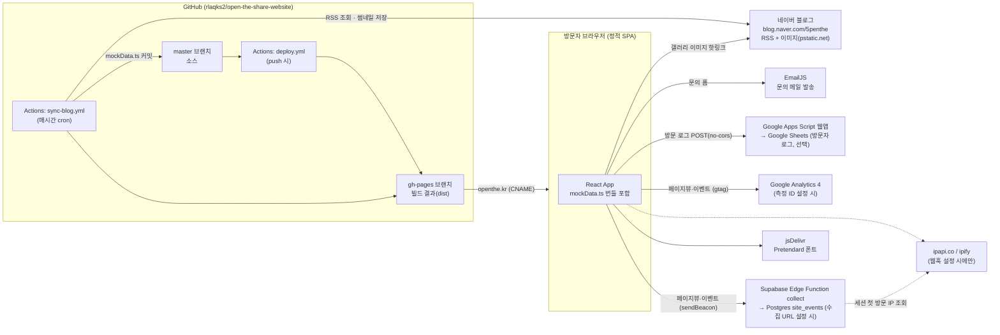

# ARCHITECTURE — 시스템 구조

## 1. 전체 그림



**핵심 포인트**: "서버" 역할은 ① 빌드 시점에 번들되는 `mockData.ts` ② GitHub Actions(배치 작업) ③ 외부 SaaS(EmailJS, Google Sheets, GA4, Supabase) 가 나눠 맡습니다.
측정 호출은 모두 `src/services/analytics.ts` 한 곳을 거칩니다 → [docs/ANALYTICS.md](../ANALYTICS.md)

## 2. 프론트엔드 구조

- **라우터 없음.** `App.tsx` 의 `currentView: 'home' | 'portfolio'` 상태로 화면을 전환합니다.
  - 그래서 URL 이 바뀌지 않고, 새로고침하면 항상 메인으로 돌아가며, 포트폴리오 개별 글의 공유 링크가 없습니다. (→ [ROADMAP](ROADMAP.md) P1)
- **모달**은 `App.tsx` 의 `activeModal: 'search' | 'inquiry' | 'portfolioDetail' | 'privacy'` 하나로 관리합니다. 동시에 하나만 열립니다.
- **섹션 이동**: 헤더 메뉴 → `handleNavigateHome(sectionId)` → `scrollIntoView`. 섹션 `id` 는 `about, programs, process, portfolio, testimonials, partners, faq, impact` 입니다. sticky 헤더에 가리지 않도록 `section[id]{scroll-margin-top:80px}` 가 `index.css` 에 있습니다.
- **애니메이션**: `useScrollObserver` 가 마운트 시점의 모든 `<section>` 에 `fade-in-section` 을 붙이고 화면에 들어오면 `is-visible` 로 바꿉니다. `prefers-reduced-motion` 사용자에게는 꺼집니다.

### 컴포넌트 의존 관계

```
main.tsx → App.tsx
  ├─ layout/Header ─────────── mockData(companyInfo, portfolioItems 개수)
  ├─ [home] sections/* ─────── mockData(각 섹션 데이터)
  ├─ [portfolio] pages/PortfolioPage ── mockData.portfolioItems (필터·검색·페이지네이션, 클라이언트 처리)
  ├─ layout/Footer ─────────── mockData(companyInfo, partners)
  └─ modals/* ──── ui/Modal (공통)
        ├─ InquiryModal → forms/InquiryForm → config/site.ts → EmailJS
        ├─ PortfolioDetailModal (갤러리: 로컬 썸네일 + 네이버 원본 핫링크, 실패 시 썸네일로 대체)
        ├─ SearchModal (자체 오버레이, ESC 닫기)
        └─ PrivacyPolicyModal → data/privacyPolicy
  (App 화면 전환·주요 행동 시) services/analytics → GA4 / Supabase collect / utils/visitorTracker(구글 시트) (UI 없음)
```

## 3. 데이터

- 모든 콘텐츠는 `src/data/mockData.ts` (약 390KB) 에 TypeScript 객체로 들어 있고 **JS 번들에 포함**됩니다. 이름은 mock 이지만 **실제 운영 데이터**입니다.
- 이미지 경로는 `` `${BASE_URL}images/...` `` 형태 (`BASE_URL` = `import.meta.env.BASE_URL` = `/`).
- 파일 끝에서 `portfolioItems` 를 `period` 내림차순으로 정렬합니다.
- 자세한 스키마/규칙은 [DATA_GUIDE](DATA_GUIDE.md).

## 4. 외부 서비스

| 서비스 | 용도 | 설정 위치 | 실패 시 동작 |
|--------|------|-----------|--------------|
| EmailJS | 파트너십 문의 메일 발송 | `src/config/site.ts` (env 로 덮어쓰기 가능) | 실패 모달 + 재시도 버튼, 대표번호 안내 |
| 네이버 블로그 RSS | 포트폴리오 자동 수집 | `scripts/sync_blog.py` | 스크립트가 조용히 종료, 사이트 영향 없음 |
| 네이버 pstatic 이미지 | 상세 모달 갤러리 | `mockData.galleryUrls` | `onError` → 로컬 썸네일로 대체 |
| Google Apps Script | 방문자 로그 수집 (선택) | `VITE_GOOGLE_SHEET_WEBHOOK_URL` (GitHub Actions Variables) | 무시 (UX 영향 없음) |
| ipapi.co / ipify | 방문자 IP·지역 조회 | 웹훅 설정 시(브라우저), Supabase 수집기(서버, 세션 첫 방문만) | 무시 |
| Google Analytics 4 | 행동 분석·전환(Ad Grants 대비) | `VITE_GA_MEASUREMENT_ID` (GitHub Actions Variables) | 무시 |
| Supabase (Edge Function + Postgres) | 1차 이벤트 원장, SQL 분석 | `VITE_ANALYTICS_COLLECT_URL` + `supabase/` (마이그레이션·함수) | 무시 |
| jsDelivr | Pretendard 웹폰트 (SRI 적용) | `index.html` | 시스템 폰트로 대체 |

## 5. 빌드·배포

- `npm run build` = `tsc` (strict, noUnusedLocals/Parameters) + `vite build` → `dist/`
- `public/` 의 파일(CNAME, 파비콘, images)은 그대로 `dist/` 로 복사됩니다.
- 상세: [DEPLOYMENT](DEPLOYMENT.md)

## 6. 알려진 구조적 한계

| 한계 | 영향 | 대응 |
|------|------|------|
| 라우터 없음 | 공유 URL·뒤로가기·SEO 불리 | ROADMAP P1: 해시 라우팅 또는 react-router + 404.html |
| 데이터가 번들에 포함 | 메인 JS ~600KB, 포트폴리오가 늘수록 초기 로딩 증가 | ROADMAP P1: 포트폴리오를 `public/data/*.json` 으로 분리해 지연 로딩 |
| 갤러리가 네이버 핫링크 | 네이버 정책 변경 시 깨질 수 있음 | `onError` 대체 처리 있음. 장기적으로 로컬 저장 |
