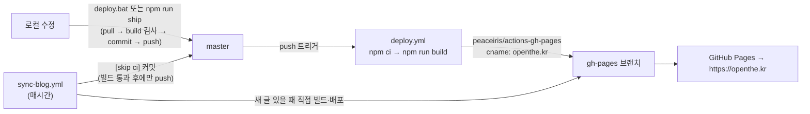

# DEPLOYMENT — 배포·도메인·롤백

## 1. 배포 파이프라인 (단일 경로)



- **공식 경로는 `master` push 하나**입니다. Actions 가 깨끗한 환경(`npm ci`)에서 빌드하므로 "내 PC에선 됐는데" 문제가 없습니다.
- 블로그 동기화 봇은 `[skip ci]` 로 커밋하여 deploy.yml 중복 실행을 막고, 대신 자기 잡에서 직접 배포합니다. 순서는 커밋 → rebase → **빌드 검사 → 통과 시에만 push** → 배포라서, 자동 생성 데이터로 빌드가 깨져도 master 는 깨지지 않습니다.
- 두 워크플로는 `concurrency: pages` 그룹을 공유해 동시에 배포되지 않습니다.
- PR 을 열면 deploy.yml 이 **빌드 검사만** 하고 배포하지 않습니다.

> 2026-11-09 이전에는 `npm run deploy`(로컬 빌드 → gh-pages 직접 업로드)와 Actions 배포가 **이중으로** 일어났습니다. 현재 로컬 업로드는 비상용 `npm run deploy:manual` 로만 남겨두었습니다.

## 1-1. 테스트 사이트 (운영 반영 전 확인용)

운영(openthe.kr)에 올리기 전에 **별도 저장소 `rlaqks2/open-the-share-dev`** 에 먼저 올려 확인합니다.

- 주소: **https://rlaqks2.github.io/open-the-share-dev/**
- 같은 `deploy.yml` 이 저장소 이름으로 구분해 동작: 하위 경로 base(`VITE_BASE_PATH=/open-the-share-dev/`), CNAME 제거, **측정(GA4·Supabase·구글 시트) 끔**, `noindex` + 탭 제목 `[DEV]`
- `sync-blog.yml` 은 운영 저장소에서만 실행 (테스트 저장소는 자동 커밋·배포 안 함)
- 테스트 저장소의 `main` 은 **운영 저장소 코드의 거울**입니다. 올릴 때마다 강제 push 로 덮어쓰므로 그쪽에서 직접 수정하지 않습니다.

```bash
# 1) 변경을 커밋 (아직 운영 master 에 push 하지 않음)
git add <파일> && git commit -m "..."
# 2) 테스트 사이트로 올리기 (build 검사 → 현재 HEAD 를 dev 저장소 main 으로 강제 push)
npm run ship:dev
# 3) 1~3분 뒤 https://rlaqks2.github.io/open-the-share-dev/ 확인 (dev 저장소 Actions 탭 초록불)
# 4) 이상 없으면 운영 반영
git push origin master
```

- 큰 작업은 `feature/...` 브랜치에서 커밋하고 `npm run ship:dev` 로 확인 → `master` 에 머지 후 push 해도 됩니다 (`ship:dev` 는 지금 체크아웃된 HEAD 를 올림).
- 커밋하지 않은 변경은 올라가지 않습니다.
- 첫 세팅(1회): dev 저장소 Settings → Pages → Source = `gh-pages` / (root), Actions 권한 Read and write.

## 2. 배포 방법

| 방법 | 하는 일 |
|------|---------|
| `deploy.bat` 더블클릭 (Windows) | `git pull --rebase --autostash` → `npm run build` 검사 → `git add -A` → commit → push |
| `npm run ship` | 위와 동일 |
| VS Code `Ctrl+Shift+B` | "빌드 검사 후 배포 (deploy.bat)" 태스크 실행 |
| GitHub → Actions → Deploy → Run workflow | 코드 변경 없이 재배포 |

배포 후 확인: GitHub 저장소 **Actions** 탭 초록불 → 1~3분 뒤 https://openthe.kr 에서 `Ctrl+F5`.

`deploy.bat`·`npm run ship` 은 먼저 `scripts/check-prod-remote.mjs` 로 **origin 이 운영 저장소(`rlaqks2/open-the-share-website`)인지 확인**하고, 아니면 중단합니다. 테스트 저장소(open-the-share-dev)를 clone 한 폴더에서 실수로 실행해 테스트 저장소 master 에 올라가는 것을 막기 위함입니다. 테스트 사이트는 `npm run ship:dev` 를 쓰세요.

⚠️ `git add -A` 는 작업 폴더의 모든 변경을 올립니다. 개인 메모·테스트 파일이 있으면 먼저 정리하세요.

## 3. 도메인 (openthe.kr)

- `public/CNAME` = `openthe.kr` → 빌드 시 `dist/CNAME` 로 복사, 워크플로에서도 `cname: openthe.kr` 로 이중 보장
- DNS (도메인 등록업체): apex `openthe.kr` → GitHub Pages A 레코드 4개(185.199.108~111.153), `www` → CNAME `rlaqks2.github.io`
- 저장소 Settings → Pages → Custom domain = `openthe.kr`, **Enforce HTTPS 체크**

## 3-1. 검색엔진 등록 (네이버·구글)

- `public/robots.txt`(전체 허용 + 사이트맵 위치, 네이버 진단 호환을 위해 ASCII 만 사용 — 한글 주석 금지), `public/sitemap.xml`(메인 주소 1개 — SPA 라 `?story=` 상세는 canonical 이 메인이라 제외)
- 빌드 때 `scripts/seo-html.ts` 가 `index.html` 에 넣는 것: ① 소유확인 메타태그 ② JSON-LD(Organization·WebSite) ③ `#root` 안 정적 본문(히어로·프로그램·연락처). 내용은 `mockData` 에서 읽으므로 문구를 바꾸면 다음 빌드에 자동 반영. React 가 뜨면 정적 본문은 실제 화면으로 교체됨
- 테스트 사이트는 `vite.config.ts` 가 `noindex` 를 넣으므로 검색에 잡히지 않음
- **등록 절차 (사람이 1회)**
  1. 네이버 서치어드바이저(searchadvisor.naver.com) → 사이트 등록 `https://openthe.kr` → 소유확인 "HTML 태그" 의 content 값을 `src/config/seo.ts` 의 `naver` 에 넣고 배포 → 확인 버튼
  2. 구글 서치 콘솔 → URL 접두어 `https://openthe.kr/` → "HTML 태그" 값을 `google` 에 넣고 배포 → 확인
  3. 두 곳 모두 사이트맵 제출: `https://openthe.kr/sitemap.xml`. 네이버는 "요청 → 웹 페이지 수집" 에 메인 주소도 요청
  4. 네이버 스마트플레이스·다음 검색등록은 사이트 코드와 무관 (회사 정보로 직접 신청)
- 소유확인 태그는 등록 후에도 지우지 않는다 (지우면 소유권이 풀림)

## 4. 환경변수 (빌드 시 주입)

| 이름 | 어디에 등록 | 비고 |
|------|------------|------|
| `VITE_GOOGLE_SHEET_WEBHOOK_URL` | 저장소 Settings → Secrets and variables → Actions → **Variables** | 방문자 로그 수집용 Apps Script 웹앱 URL. 비우면 수집 안 함. 설정법: [VISITOR_LOG](../VISITOR_LOG.md) |
| `VITE_EMAILJS_*` | (선택) 동일 | 비우면 `src/config/site.ts` 기본값 |
| `CONTENT_INGEST_TOKEN` | 운영 저장소 Settings → Secrets and variables → Actions → **Secrets** (Variables 아님) | 블로그 봇이 Supabase 콘텐츠 DB 에 새 글을 쓰는 토큰. **없으면 sync-blog.yml 이 실패**합니다. 빌드(deploy.yml)에는 필요 없음. 교체법: [DATA_GUIDE §3](DATA_GUIDE.md) |

로컬은 `.env.example` → `.env.local` 로 복사해서 사용 (`.env*` 는 git 제외).

**콘텐츠 DB 와 빌드**: `npm run build` 는 먼저 Supabase 에서 포트폴리오·언론보도를 받아옵니다(`scripts/pull-content.mjs`, 공개 키라 시크릿 불필요). Actions 에서 조회가 실패하면 빌드가 중단되고 운영 사이트는 이전 배포 그대로입니다. Supabase 프로젝트가 일시정지되면 대시보드에서 Restore 후 재실행하세요.

## 5. 롤백

1. **가장 빠름**: GitHub → Actions → 마지막 성공한 Deploy 실행 → "Re-run all jobs" 는 그 시점 커밋으로 다시 빌드합니다.
2. **코드 되돌리기**: `git revert <문제 커밋>` → push (이력 보존, 권장)
3. **gh-pages 직접 되돌리기**(비상): `git push origin <이전 gh-pages 커밋>:gh-pages --force` — 다음 배포 때 덮어써짐에 유의

## 6. 사전 점검 (첫 세팅/권한 문제 시)

- Settings → Actions → General → Workflow permissions = **Read and write**
- Settings → Pages → Source = **Deploy from a branch: gh-pages / (root)**
