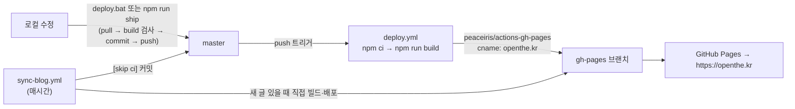

# DEPLOYMENT — 배포·도메인·롤백

## 1. 배포 파이프라인 (단일 경로)

- **공식 경로는 `master` push 하나**입니다. Actions 가 깨끗한 환경(`npm ci`)에서 빌드하므로 "내 PC에선 됐는데" 문제가 없습니다.
- 블로그 동기화 봇은 `[skip ci]` 로 커밋하여 deploy.yml 중복 실행을 막고, 대신 자기 잡에서 직접 배포합니다.
- 두 워크플로는 `concurrency: pages` 그룹을 공유해 동시에 배포되지 않습니다.
- PR 을 열면 deploy.yml 이 **빌드 검사만** 하고 배포하지 않습니다.

> 2026-11-09 이전에는 `npm run deploy`(로컬 빌드 → gh-pages 직접 업로드)와 Actions 배포가 **이중으로** 일어났습니다. 현재 로컬 업로드는 비상용 `npm run deploy:manual` 로만 남겨두었습니다.

## 2. 배포 방법

| 방법 | 하는 일 |
|------|---------|
| `deploy.bat` 더블클릭 (Windows) | `git pull --rebase --autostash` → `npm run build` 검사 → `git add -A` → commit → push |
| `npm run ship` | 위와 동일 |
| VS Code `Ctrl+Shift+B` | "빌드 검사 후 배포 (deploy.bat)" 태스크 실행 |
| GitHub → Actions → Deploy → Run workflow | 코드 변경 없이 재배포 |

배포 후 확인: GitHub 저장소 **Actions** 탭 초록불 → 1~3분 뒤 https://openthe.kr 에서 `Ctrl+F5`.

⚠️ `git add -A` 는 작업 폴더의 모든 변경을 올립니다. 개인 메모·테스트 파일이 있으면 먼저 정리하세요.

## 3. 도메인 (openthe.kr)

- `public/CNAME` = `openthe.kr` → 빌드 시 `dist/CNAME` 로 복사, 워크플로에서도 `cname: openthe.kr` 로 이중 보장
- DNS (도메인 등록업체): apex `openthe.kr` → GitHub Pages A 레코드 4개(185.199.108~111.153), `www` → CNAME `rlaqks2.github.io`
- 저장소 Settings → Pages → Custom domain = `openthe.kr`, **Enforce HTTPS 체크**

## 4. 환경변수 (빌드 시 주입)

| 이름 | 어디에 등록 | 비고 |
|------|------------|------|
| `VITE_GOOGLE_SHEET_WEBHOOK_URL` | 저장소 Settings → Secrets and variables → Actions → **Variables** | 방문자 로그 수집용 Apps Script 웹앱 URL. 비우면 수집 안 함. 설정법: [VISITOR_LOG](../VISITOR_LOG.md) |
| `VITE_EMAILJS_*` | (선택) 동일 | 비우면 `src/config/site.ts` 기본값 |

로컬은 `.env.example` → `.env.local` 로 복사해서 사용 (`.env*` 는 git 제외).

## 5. 롤백

1. **가장 빠름**: GitHub → Actions → 마지막 성공한 Deploy 실행 → "Re-run all jobs" 는 그 시점 커밋으로 다시 빌드합니다.
2. **코드 되돌리기**: `git revert <문제 커밋>` → push (이력 보존, 권장)
3. **gh-pages 직접 되돌리기**(비상): `git push origin <이전 gh-pages 커밋>:gh-pages --force` — 다음 배포 때 덮어써짐에 유의

## 6. 사전 점검 (첫 세팅/권한 문제 시)

- Settings → Actions → General → Workflow permissions = **Read and write**
- Settings → Pages → Source = **Deploy from a branch: gh-pages / (root)**
