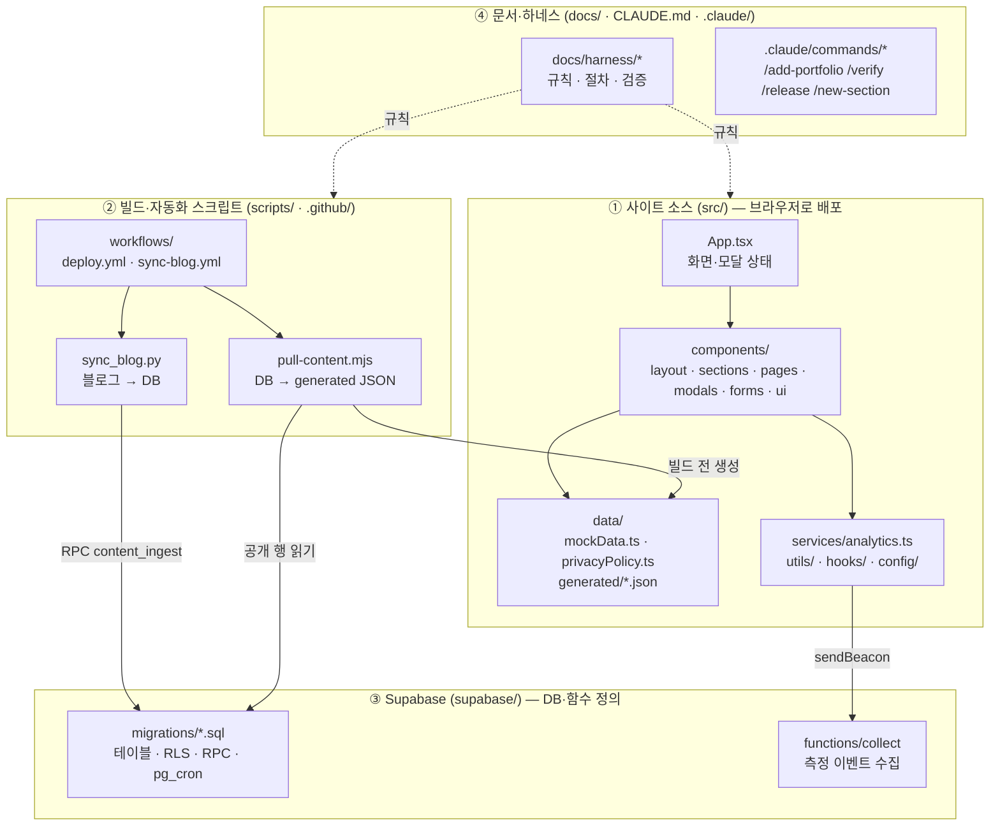
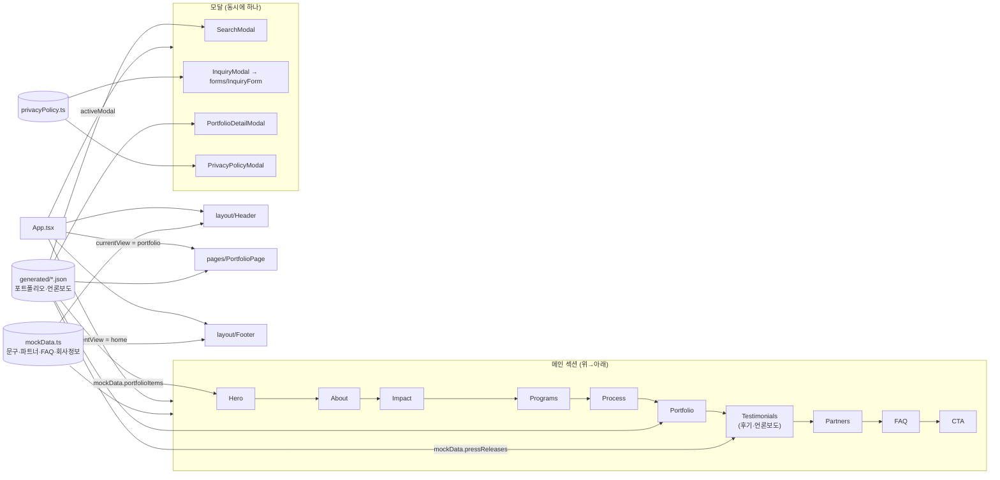
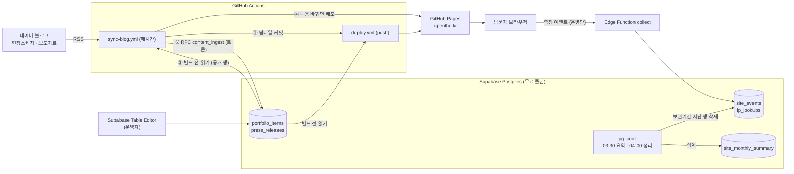

# STRUCTURE — 전체 소스 구조도

> 이 저장소의 **모든 파일이 어디에 있고 서로 어떻게 연결되는지** 한 장에 정리한 문서입니다.
> 동작 원리(외부 서비스·실패 시 동작)는 [ARCHITECTURE](ARCHITECTURE.md), 데이터 규칙은 [DATA_GUIDE](DATA_GUIDE.md), 보관 규칙은 [DATA_RETENTION](DATA_RETENTION.md).
> 파일을 추가·삭제·이동하면 이 문서의 해당 그림과 표를 같은 커밋에서 고칩니다. (마지막 갱신 2026-11-25)

---

## 1. 큰 그림 — 4개 영역



## 2. 폴더 트리 (역할 주석)

```
open-the-share-dev/
├── CLAUDE.md                      ★ 에이전트·사람이 가장 먼저 읽는 규칙 (R1~R9)
├── AGENTS.md                      다른 AI 도구용 진입점 → CLAUDE.md
├── README.md                      저장소 소개·빠른 시작
├── index.html                     SPA 진입 HTML (no-referrer 메타 R3, OG 태그)
├── package.json                   npm 스크립트 (dev/build/typecheck 가 먼저 content:pull)
├── vite.config.ts                 base 경로(운영 '/', 테스트 '/open-the-share-dev/'), [DEV] 표시, SEO 플러그인
├── tailwind.config.js             brand(로고 블루)·amber 팔레트
├── tsconfig*.json                 strict + noUnusedLocals (R5)
├── .env.example                   환경변수 예시 (.env.local 로 복사, git 제외)
├── deploy.bat / setup.bat / quickstart.ps1 / 기획자_원클릭_셋업.bat   Windows 원클릭 실행
│
├── src/
│   ├── main.tsx                   React 진입점
│   ├── App.tsx                    ★ 화면('home'|'portfolio') + 모달 상태, ?story= 공유 링크, 페이지뷰 측정
│   ├── index.css                  Tailwind + 전역 스타일 (section scroll-margin)
│   ├── types.ts                   PortfolioItem / PartnerItem / PressReleaseItem
│   ├── vite-env.d.ts              import.meta.env 타입
│   ├── config/site.ts             외부 서비스 공개 설정 (EmailJS 등)
│   ├── config/seo.ts              검색엔진 소유확인 코드 (네이버·구글, 공개값)
│   ├── data/
│   │   ├── mockData.ts            ★ 문구·프로그램·파트너·FAQ·회사정보 (코드로 관리)
│   │   ├── privacyPolicy.ts       개인정보 처리방침 + 문의폼 고지 (R8)
│   │   └── generated/             ⚙ 빌드 때 생성 (git 제외, 직접 수정 금지)
│   │       ├── portfolio.json     ← Supabase portfolio_items
│   │       └── press.json         ← Supabase press_releases
│   ├── components/
│   │   ├── layout/                Header, Footer
│   │   ├── sections/              메인 10개 섹션 (아래 3장 순서)
│   │   ├── pages/PortfolioPage    전체 아카이브 (필터·검색·페이지네이션)
│   │   ├── modals/                Search, Inquiry, PortfolioDetail, PrivacyPolicy
│   │   │                          (Login·Signup·FindAccount 는 미사용 — 로그인 기능 없음, ROADMAP 참고)
│   │   ├── forms/InquiryForm      파트너십 문의 → EmailJS
│   │   └── ui/Modal               공통 모달 (ESC·바깥 클릭·스크롤 잠금)
│   ├── services/analytics.ts      ★ 측정 단일 진입점 → GA4 · Supabase collect · 구글 시트
│   ├── hooks/useScrollObserver    섹션 페이드인
│   └── utils/                     a11y(clickableProps), visitorTracker(세션 ID·시트 전송)
│
├── public/                        그대로 dist/ 로 복사
│   ├── CNAME                      openthe.kr
│   ├── images/portfolio/          포트폴리오 썸네일 item_NNN.jpg (봇이 추가·커밋)
│   ├── images/partners/           참여기관 로고 partner_NN.png
│   ├── favicon*, ci.png …
│   └── content-version.txt        ⚙ 빌드 때 생성 (콘텐츠 해시, git 제외)
│
├── scripts/
│   ├── content-source.json        Supabase URL + publishable 키 (공개값)
│   ├── pull-content.mjs           ★ 빌드 전 DB → src/data/generated/*.json
│   ├── sync_blog.py               ★ 네이버 블로그 RSS → 썸네일 + DB (--stage / --ingest-pending)
│   ├── check-prod-remote.mjs      ship/deploy.bat 가 운영 저장소인지 확인
│   └── seo-html.ts                빌드 때 index.html 에 소유확인 태그·JSON-LD·정적 본문(mockData 기반) 삽입
│
├── supabase/
│   ├── config.toml                collect 함수 verify_jwt=false
│   ├── functions/collect/         측정 이벤트 검증·저장 (Origin·이벤트명·크기·분당 제한)
│   └── migrations/
│       ├── 20261109000000_site_events.sql       측정 원장·IP 캐시·분석 뷰·1년 파기
│       ├── 20261109120000_monthly_summary.sql   월별 요약(장기 추세)
│       ├── 20261125000000_site_content.sql      포트폴리오·언론보도 테이블·RLS·봇 RPC
│       └── 20261125120000_data_hygiene.sql      purge_stale_data()·보관 규칙·v_storage_usage
│
├── .github/workflows/
│   ├── deploy.yml                 master/main push → 빌드 → gh-pages (운영·테스트 겸용)
│   └── sync-blog.yml              매시간: 블로그 → DB → 내용 바뀌면 빌드·배포
│
├── .claude/
│   ├── commands/                  /add-portfolio /verify /release /new-section
│   └── launch.json                미리보기 서버 (dev 5173 / preview 4173 / 4174)
│
└── docs/
    ├── harness/                   ★ 하네스 (이 문서 포함, 4장 표)
    ├── PLANNER_GUIDE.md           비개발자 작업 가이드
    ├── ANALYTICS.md               측정 설정·이벤트·SQL
    ├── DATA_COLLECTED.md          수집 데이터 전체 명세
    ├── VISITOR_LOG.md             구글 시트 방문 로그 (종료 예정)
    └── current_specs.md           화면·기능 명세
```

## 3. 화면 구성 — 컴포넌트와 데이터 출처



| 데이터 | 원본 | 수정 방법 | 화면 반영 |
|---|---|---|---|
| 문구·프로그램·프로세스·파트너·FAQ·회사정보 | `src/data/mockData.ts` | 코드 수정 → push | `master` push 시 배포 |
| 포트폴리오·언론보도 | Supabase `portfolio_items`·`press_releases` | Table Editor / 블로그 봇 | 다음 `sync-blog.yml` 실행 때 (내용이 바뀌었으면) |
| 처리방침·문의폼 고지 | `src/data/privacyPolicy.ts` | 코드 수정 (R8) | push 시 배포 |
| 이미지 | `public/images/**` | 파일 추가 → push (R6) | push 시 배포 |

## 4. 데이터 흐름 — 콘텐츠·측정·배포



- **방문자 브라우저 → Supabase 는 "측정 쓰기"(collect) 하나뿐**입니다. 콘텐츠는 빌드 때 구워지므로 방문자 수와 무관하게 DB 를 읽지 않습니다.
- 테스트 사이트(rlaqks2.github.io/open-the-share-dev)는 같은 DB 에서 콘텐츠를 **읽기만** 하고, 측정은 꺼져 있어 아무것도 쓰지 않습니다.

## 5. 무엇을 고치면 어디가 바뀌나 (빠른 색인)

| 하고 싶은 일 | 파일 | 하네스 |
|---|---|---|
| 섹션 문구·FAQ·파트너 | `src/data/mockData.ts` | [WORKFLOWS W1·W3](WORKFLOWS.md) |
| 포트폴리오·언론보도 | Supabase Table Editor | [DATA_GUIDE §2·3](DATA_GUIDE.md), `/add-portfolio` |
| 새 섹션 | `components/sections/*` + `mockData.ts` + `App.tsx` | [WORKFLOWS W4](WORKFLOWS.md), `/new-section` |
| 측정 이벤트 추가 | `services/analytics.ts` + `supabase/functions/collect` 허용목록 (+재배포) | [ANALYTICS](../ANALYTICS.md) |
| DB 테이블·보관기간 | `supabase/migrations/*.sql` (새 파일로) | [DATA_RETENTION](DATA_RETENTION.md) |
| 블로그 수집 규칙 | `scripts/sync_blog.py` | [DATA_GUIDE §3](DATA_GUIDE.md), [VERIFICATION L4](VERIFICATION.md) |
| 배포 경로·환경변수 | `.github/workflows/*`, `vite.config.ts` | [DEPLOYMENT](DEPLOYMENT.md) |
| 처리방침 | `src/data/privacyPolicy.ts` | CLAUDE.md R8 |
| 검색 노출(소유확인·사이트맵·구조화 데이터) | `src/config/seo.ts`, `scripts/seo-html.ts`, `public/robots.txt`·`sitemap.xml` | [DEPLOYMENT §3-1](DEPLOYMENT.md) |
